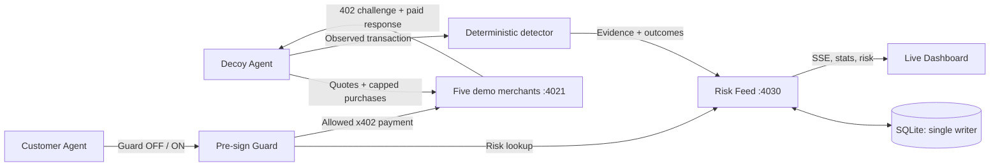

# Bait

**Bait tests AI-agent sellers before your agent pays them.**

> Bait gets scammed first, so your agent doesn't.

Bait is a hackathon-stage **AI Agent Payment Risk Intelligence Platform**. A capped decoy buyer probes five *team-controlled demonstration merchants*, records observed payment and delivery behavior, publishes a merchant-level risk feed, and gives the customer's x402 payment client a risk check **before signing**. This is an experimental safety workflow, **not a production fraud verdict engine**.

**B4 status (2026-11-11):** Latest integrated main at sync: `5ae583e`, including merged A security PR #14, B3 PR #1, B0/B1/B2. **Real-module Mock E2E PASSED on Windows and Ubuntu** ([CI evidence](https://github.com/MO7YW4NG/bait/actions/runs/43027668695)). The actual A x402 Merchant/Buyer/Guard, B1 Feed, B2 Dashboard and B3 Customer were exercised using disposable keys and simulated facilitator settlements. No funded Base Sepolia settlement has been verified. B5 PR #6 remains Draft.

## Problem and market background

Agents can accept API quotes and authorize payments automatically. Stablecoin transfers cannot rely on ordinary card chargeback procedures. Price changes, repeated settlement, non-delivery and hostile instructions in purchased content therefore require a **payment-time policy**, not just a more careful language-model prompt.

**External source, not a Bait measurement:** BlockRun reports that **7 of 10** frontier models paid a cheating seller at least once and **6 of 10** bought the same data twice in its *Agent Money Benchmark v1* (test runs 27–29 October 2026). The benchmark used **Solana mainnet USDC**, **not x402**; its adversarial marketplace sellers were simulated. It was run and published by BlockRun, and complete task records were not public. The results are not an independently replicated estimate of real-world seller risk. Sources: [original benchmark](https://agentmoneybench.com/), [published repository](https://github.com/BlockRunAI/agent-money-bench), [methodology caveats, Solana Compass (3 November 2026)](https://solanacompass.com/news/blockruns-agent-money-benchmark-gave-10-ai-models-real-usdc-on-solana-and-7-paid-a-cheating-seller).

**Bait's distinction:** BlockRun evaluated *agents* buying from adversarial sellers; Bait proposes to evaluate *seller behavior* and publish evidence that separate agents can query before paying. This MVP tests only its **own artificial merchants**. Third-party merchant probing is future work.

## Architecture



The baseline **Guard OFF** intentionally bypasses risk decisions while respecting configured spending caps. The **Guard ON** path checks the feed, quoted amount and spend control before producing an x402 payment signature.

### Decoy Agent workflow

For each merchant, the scripted decoy calls `GET /merchants`, requests `GET /m/:id/quote`, attempts a paid x402 request with a stable `X-Request-Id` and, **only on an explicit retry response**, repeats the request with the same ID. It then compares the final body and settlement records with deterministic rules and posts the transaction **even if clean** via `POST /evidence`. This allows clean sellers to earn a positive outcome. The risk feed stores evidence; no demo component should invent receipts.

| Controlled merchant ID | Listed price | Intended observation | Rule flag |
| --- | ---: | --- | --- |
| `honest` | 0.010 USDC | Correct price, valid weather JSON | none |
| `price-switch` | 0.010 | Payment requires 0.050 instead | `PRICE_CHANGE` |
| `ghost` | 0.010 | Payment settled but product missing | `NON_DELIVERY` |
| `double` | 0.010 | Second paid call for same request ID | `DOUBLE_CHARGE` |
| `injector` | 0.010 | Adversarial instruction in purchased content | `PROMPT_INJECTION` |

These are controlled demonstration scenarios, not allegations against real merchants. All five were exercised in B4's Mock E2E; source: [plan.md](./plan.md), sections 4.1–4.4.

## Risk Feed API and scoring

The B1-owned HTTP contract is:

| Endpoint | Intended use |
| --- | --- |
| `GET /health` | Readiness |
| `GET /risk?url=...` | Merchant verdict, score and evidence |
| `GET /merchants` | Dashboard merchant records |
| `GET /stats` | Latest Guard OFF/ON run counters |
| `GET /events` | Dashboard SSE stream |
| `POST /evidence` | Decoy evidence and outcomes |
| `POST /report` | Crowdsourced outcome requiring a payment-like hash |
| `POST /spend` | Customer run spending and blocks |
| `POST /events` | Agent status events |
| `POST /reset` | **Destructively clears the feed's data** |

The feed server is the **only owner** of `node:sqlite`. Store USDC atomic units as decimal **strings** and calculate with `bigint`, not floating-point currency amounts. **B0’s `DemoStats` contract returns `off.spent`, `off.wasted`, `on.spent` and `on.wasted` as integer atomic-unit strings** (e.g. `"60000"` = `0.060000` USDC); B4 converts them exactly for presentation rather than treating them as display decimals.

The design specifies the following **weighted reputation score**, not a calibrated fraud probability:

```text
score = (1 + G) / (2 + G + B)
G = weighted good outcomes; B = weighted bad outcomes
decoy clean:   G=5, B=0 => 6/7 = 0.857 (ok)
decoy flagged: G=0, B=5 => 1/7 = 0.143 (risky)
```

A decoy result has weight **5**; a crowd report has weight **1**. With no outcomes, the verdict is `unknown`; otherwise it is `risky` when the score is below `GUARD_MIN_SCORE` (planned default **0.6**), and `ok` at or above that threshold. Eight subsequent good weight-1 reports bring a single bad decoy outcome to 0.6, illustrating the retest mechanism. The score can be gamed and is **not** independent proof a seller is safe.

Real Base Sepolia settlement evidence may link to [Base Sepolia Basescan](https://sepolia.basescan.org/). A `0xmock...` transaction hash represents a **simulated settlement**, is **not on-chain**, and must not link to a block explorer. A report hash passing regex validation is also not the same as independently verifying payment on-chain.

## Guard SDK usage

The A-owned API agreed in [plan.md](./plan.md) has this intended shape:

```ts
import { guardedFetch, baitHook } from "./src/guard/guardedFetch.js";

const outcome = await guardedFetch("http://localhost:4021/m/honest/data", {
  privateKey: process.env.CUSTOMER_PRIVATE_KEY!,
  requestId: "demo-order-001",
  quotedAtomic: 10_000n, // USDC atomic units (0.010000 USDC)
  feedUrl: "http://localhost:4030",
  minScore: 0.6,
  maxPriceUsdc: "0.10",   // Decimal string, as required by A's Buyer SDK
});
if (!outcome.allowed) console.log("Blocked before signing:", outcome.reason);

// For an existing x402Client:
// client.onBeforePaymentCreation(baitHook({ feedUrl: "...", minScore: 0.6 }));
```

**This is the actual A-owned Guard SDK signature in merged main**, not the original draft interface. The Guard checks the feed inside x402's `onBeforePaymentCreation` callback, aborting on a risky seller or unexpected amount. A's implementation defaults to fail closed when the risk feed is unreachable, and enforces a smaller limit for unknown merchants. The x402 `spendControls` separately caps each payment. B4 has inspected this interface but **has not verified a complete paid Guard ON/OFF run**.

## Installation and configuration

Requirements: **Node.js 24**, **pnpm 10**, Windows/macOS/Linux. **Default Mock mode requires no funded wallet, external RPC, faucet, GMI credential or local .env.** B4 generates disposable wallet secrets **only in memory**. The real A x402 Buyer still creates signatures against a controlled Merchant; Mock Facilitator returns simulated receipts, not chain transactions.

```text
git clone https://github.com/MO7YW4NG/bait.git
cd bait
pnpm install
pnpm demo                # Safe default; isolated Mock E2E, Dashboard stays open
# Ctrl+C                  # Clean up only processes/data started by this demo
```

Other commands:

```text
pnpm demo --check        # Non-mutating local prerequisite check; no payments
pnpm demo --pause 5      # Narration-friendly 5 second transitions
pnpm demo --once         # CI mode: complete the entire sequence, then exit
pnpm preflight           # For real Base Sepolia wallet/facilitator readiness
pnpm demo --live         # Explicit opt-in: actual Base Sepolia testnet payments
```

**Live safety:** `--live` is the only way B4 enables non-mock settlement. Provide dedicated, funded Base Sepolia-only wallet keys, recipient address, supported facilitator and real RPC in local `.env`, and run `pnpm preflight` first. `pnpm demo --live` also runs the preflight itself and rejects non-Base-Sepolia chain IDs; it never falls back to mock after a live failure. Never use mainnet wallets or valuable funds.

### Environment variables

| Name | Mock default | Explicit `--live` |
| --- | --- | --- |
| `DECOY_PRIVATE_KEY` / `CUSTOMER_PRIVATE_KEY` | Replaced with two new in-memory disposable keys | Required dedicated funded Base Sepolia keys |
| `MERCHANT_PAYTO` | Disposable recipient address | Required explicit testnet recipient |
| `RPC_URL` | Local **chain-ID-only simulation** (does not claim balances) | Configured actual Base Sepolia RPC; must return 84532 |
| `FACILITATOR_URL` | Not used for on-chain settlement | x402 Base Sepolia facilitator |
| `MOCK_FACILITATOR` | Forced to `1` by B4 | Forced to `0` only by `--live` |
| `MERCHANT_URL` / `FEED_URL` | Loopback, preferred ports 4021 / 4030; falls back to unused ports | Same isolated service policy |
| `GUARD_MIN_SCORE` / `MAX_PRICE_PER_CALL_USDC` | Reproducible scenario thresholds 0.6 / 0.10 | Configured policy; B3 caps max price at 0.10 |
| `GMI_API_KEY` / `CUSTOMER_MODEL` / `JUDGE_MODEL` | Optional; not needed for scripted flow | Optional |
| `STRIPE_SECRET_KEY` | Not used | Out of B4 scope |

Keep `.env` untracked. In Mock mode even any configured wallet keys are overridden by disposable ones to avoid accidentally exposing or signing with real wallets. All results should be labelled **SIMULATED**.

## One-command sequence and isolation

1. Preflight: verify Node, `tsx`, B0 scripts and required sources, URLs and safe wallet configuration; in Mock mode start a clearly labeled **chain-ID-only RPC stub**. In `--live` mode validate the actual RPC and run the real preflight (balance, facilitator, model checks).
2. Reserve dedicated loopback Merchant and Feed ports. Prefer 4021 and 4030; if occupied, use free ephemeral ports. **Never reuse or reset someone else's instance.**
3. Start A Merchant Zoo and validate `/health` plus five merchant IDs.
4. Start the B4-specific `src/demoFeed.ts` wrapper around the actual B1 feed, with a **new SQLite file in an OS temporary directory**. Check session ownership before ever calling `POST /reset`. A default shared `data/bait.db` can never be opened by this wrapper.
5. Check B2 Dashboard HTML, `/app.js`, `/app.css`, and SSE backend availability.
6. `POST /reset` **only** to the freshly started demo-owned Feed; no shared database is touched.
7. Run the actual A Decoy across five controlled merchants and wait for rule-backed Risk Feed evidence.
8. Run B3 scripted Customer Guard OFF, then Guard ON.
9. Read actual `GET /stats` (integer atomic units), require correct comparison counters, print a USDC summary; abort on mismatches. No hardcoded successes.
10. Show the actual Dashboard URL and keep services running for judges until Ctrl+C. Cleanup terminates **only demo-created child processes** and deletes only the session's temporary SQLite files. `--once` exits after verification.

Node child-process API is used without shell-dependent commands; startup, evidence and per-agent timeouts are 20s, 40s and 120s. If a port is taken between check and spawn, fail closed rather than reset an unowned service.

### Observed Mock E2E, not on-chain

The following were **read from a running B1 feed** during a full A/B1/B2/B3/B4 [Windows/Ubuntu Mock E2E GitHub Actions run](https://github.com/MO7YW4NG/bait/actions/runs/43027668695), **not written as result fixtures**. Separately, `src/demo.contract.test.ts` uses synthetic HTTP fixtures only to test wire format.

| Observable | Measured Mock result |
| --- | --- |
| Decoy merchant classification | 1 `ok` (`honest`), 4 `risky` (`price-switch` / `ghost` / `double` / `injector`) |
| Guard OFF | `spent="100000"` = 0.100000 USDC, `wasted="60000"` = **0.060000**, injections=1 |
| Guard ON | `spent="10000"` = 0.010000 USDC, `wasted="0"` = **0.000000**, blocked=4 |
| Mock payments | `0xmock...` receipts with `simulated=true` and **no explorer links** |
| SSE | Payment-settled and Guard-blocked events observed; A Guard and B3 Customer both emit block events, so count **four unique customer blocks**, not eight events |
| Dashboard | Served correctly from the isolated B1 Feed (HTML, JS, CSS) |
| Real Base Sepolia settlement | **SKIP:** no independently authorized funded wallets / real facilitator receipt in this B4 acceptance |

**Limitations:** this proves only the controlled scenario using the real x402 code with **mock settlement**, not real USDC transfers, third-party merchant wrongdoing, a production security warranty, or a measured population fraud rate.

## 90-second video

Follow [docs/DEMO_90S.md](./docs/DEMO_90S.md): 0–20s problem, 20–40s Decoy, 40–65s observed Guard OFF/ON, 65–80s Dashboard/SSE evidence, 80–90s conclusion. Use the run's exact numbers with an explicit **SIMULATED — NOT ON-CHAIN** label. The script is ready; a finished 90-second video has **not** been recorded or uploaded by B4.

## Responsible design

- **Controlled test merchants and testnet only:** never accuse a third-party merchant of fraud based on these synthetic cases.
- **Capped wallets:** separate wallets, limited funding, x402 spend controls and quote verification.
- **Before signing, not after losing funds:** do not claim reversibility of settled payments.
- **Evidence over accusations:** report observable prices, delivery payloads, rule labels, and settlement provenance.
- **Advisory AI:** a judge may explain, but must not change the deterministic risk score.
- **Fail closed:** unknown/unavailable feed must not quietly become a positive safety verdict in guard mode.
- **Retesting and appeal:** mutable scores need independent evidence, identity checks, and an avenue for correction before real-world use.
- **No fabricated receipts:** mock settlement hashes are not on-chain, and hash syntax validation alone is not independent verification.

## Integration gates and current scope

| Module | Current integration state |
| --- | --- |
| B0, B1, B2, A Payment Core (including PR #14), B3 Customer (PR #1) | **Merged main** and used in B4 Mock E2E |
| B4 demo process manager, isolated database/ports, CI and storyboard | **Authored on feat/b4-demo**; Mock E2E passed Windows + Ubuntu |
| B5 QA PR #6 | **Draft**. Replayed B5's unchanged tests on merged A/B3/B4: **7/7 Guard safety PASS**, **16 PASS / 0 FAIL / 3 SKIP** in isolated QA; overall remains **PARTIAL, not release-certified** ([CI 43028875475](https://github.com/MO7YW4NG/bait/actions/runs/43028875475)) |
| Funded Base Sepolia testnet settlement | **SKIP**; real credentials, funding and explorer receipt not available in this acceptance |
| Stripe card rail, production deployment and live third-party merchant scoring | **Not implemented in B4** |

B4 acceptance commands, all on Node 24:

```text
pnpm check
node --experimental-strip-types --test src/demo.test.ts
pnpm exec tsx --test src/demo.contract.test.ts
pnpm exec tsx --test src/demo.e2e.test.ts
pnpm demo --once
```

For a live judge-facing dashboard, use plain `pnpm demo` and close it using Ctrl+C. The mock test is not independent B5 release certification; do not conflate them.

### Technical and numeric sources

- [Bait build plan](./plan.md) — demonstration dataset definition, numeric targets, API and scoring.
- [Team split and acceptance](./TEAM_SPLIT.md) — ownership and integration boundaries.
- [BlockRun Agent Money Benchmark](https://agentmoneybench.com/) — vendor-reported external context, **not Bait measurements**.
- [Node child_process](https://nodejs.org/api/child_process.html) — cross-platform process lifecycle.
- [x402 documentation and SDK](https://github.com/coinbase/x402) — payment protocol; verify implementation against installed x402 v2 API.
- [Base Sepolia explorer](https://sepolia.basescan.org/) — actual testnet transaction receipts only.
