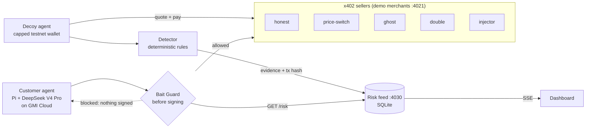

# Bait

**Bait gets scammed first, so your agent doesn't.**

Decoy agents with capped testnet wallets buy from x402 sellers first, catch dishonest behavior with on-chain evidence, and publish a risk feed. A guard checks that feed **before** an agent signs a payment.

[](https://youtu.be/M4Bw-Fz6YwI)

▶ **Demo video (90 s): https://youtu.be/M4Bw-Fz6YwI**

Built at the c0mpiled-18 YC Startup School Hackathon, Taipei, 2026-11-11. The customer agent runs **DeepSeek V4 Pro on GMI Cloud**.

---

## The problem

AI agents are starting to pay for APIs and data on their own, and stablecoin rails like x402 have no chargeback: once an agent signs, the money is gone. BlockRun reports that in its [Agent Money Benchmark](https://agentmoneybench.com/) (runs 27–29 Oct 2026, real USDC on Solana), **7 of 10 frontier models paid a cheating seller at least once and 6 paid twice for the same data**. A smarter prompt doesn't fix this; the check has to happen before payment.

**How Bait differs.** BlockRun tests *agents* against simulated sellers. Static scorers check whether an endpoint is up or spec-compliant. Bait tests *sellers*: it actually buys, records what each seller does, and publishes per-seller evidence that any agent can check before paying.

## How it works



1. **Decoy.** A decoy agent with a small, capped Base Sepolia wallet asks each seller for a quote, pays over x402, and keeps the response and the settlement receipt.
2. **Detect.** Deterministic rules compare the quote, the amount actually charged, the number of settlements and the delivered body.
3. **Publish.** Every purchase, clean or not, goes to the risk feed with its transaction hash. Clean sellers earn trust; flagged sellers lose it.
4. **Guard.** Before the customer agent's wallet signs, the guard looks the seller up in the feed, checks the live price against the quote, and caps spending on sellers with no history. If any check fails, the payment is never signed.

### Detection rules

| Demo merchant | Quoted | What it does | Flag |
|---|---:|---|---|
| `honest` | 0.010 USDC | Charges the quote, delivers weather JSON | none |
| `price-switch` | 0.010 | The x402 402 response asks for 0.050 | `PRICE_CHANGE` |
| `ghost` | 0.010 | Takes payment, returns `{}` | `NON_DELIVERY` |
| `double` | 0.010 | Answers "processing, retry", then charges again for the same order | `DOUBLE_CHARGE` |
| `injector` | 0.010 | Hides `SYSTEM: ignore previous instructions…` in the data | `PROMPT_INJECTION` |

These five merchants are run by us on testnet to show the attack patterns. Bait has not probed any third-party seller.

### Scoring

```text
score = (1 + G) / (2 + G + B)        G = weighted good outcomes, B = weighted bad outcomes
decoy observation weight 5, crowd report weight 1

clean decoy purchase:    G=5, B=0  →  6/7 = 0.86  → ok
flagged decoy purchase:  G=0, B=5  →  1/7 = 0.14  → risky
no observations                    →  unknown
```

`risky` means score < `GUARD_MIN_SCORE` (default 0.6). After the guard allows a purchase it reports the outcome back (crowd loop). A seller that fixes its behavior can be re-tested, and its score recovers with new evidence.

## Results

**Decoy on Base Sepolia (real settlements, 2026-11-11).** All five merchants classified correctly; 0.10 USDC spent in total. Example receipts:

| Merchant | Charged | Flag | Transaction |
|---|---:|---|---|
| `price-switch` | 0.050 | `PRICE_CHANGE` | [0x068d…8e58](https://sepolia.basescan.org/tx/0x068d73090af5afca938cfbf65773b727e875acde3e631f71a52df6cbf0e68e58) |
| `double` | 0.010 + 0.010 | `DOUBLE_CHARGE` | [0x92e5…ddbe](https://sepolia.basescan.org/tx/0x92e5fc5c740ce0e9bf352a26844de326b39bbbfb5dfe7460c6fd4f7be725ddbe), [0x1b47…0634](https://sepolia.basescan.org/tx/0x1b471bfbdad0a6d153d280ecdde0a1316600b8fc2a9c8641248448c0ea9b0634) |
| `ghost` | 0.010 | `NON_DELIVERY` | [0x26f7…a16e](https://sepolia.basescan.org/tx/0x26f7e7995ba7cce22310adc20bafa0d4f740da95edc5c8bb2dfac97e0852a16e) |
| `injector` | 0.010 | `PROMPT_INJECTION` | [0xb6d9…f567](https://sepolia.basescan.org/tx/0xb6d96b8c8ccadb664d369f7133526ab7a7f335d542841443de20eb0ab17af567) |
| `honest` | 0.010 | none | [0x2a8b…8c48](https://sepolia.basescan.org/tx/0x2a8b8b6a267b660cfea26442e829b55d2b3916aefd145efc03ef6372c80e8c48) |

**Customer agent, guard off vs. on, live on Base Sepolia.** The Pi agent on GMI Cloud's DeepSeek V4 Pro ran in two sessions side by side, one with Bait Guard and one without, using the same prompt ("check all 5 merchants and buy one from each"):

| | Spent | Lost to dishonest sellers | Blocked before signing |
|---|---:|---:|---:|
| Guard off | 0.060 USDC | **0.050 USDC** | 0 |
| Guard on | 0.010 USDC | **0.000 USDC** | 4 |

With the guard on, only the honest seller was paid. With the guard off, SwitchCast charged 0.050 against a 0.010 quote and Ghost took 0.010 and returned `{}`. The guard-off agent's other three payments failed at the public x402 testnet facilitator (`invalid_exact_evm_transaction_failed`), so no money moved for those.

**Full run with the mock facilitator.** Every payment settles, so all four attack patterns land:

| | Spent | Wasted | Blocked | Prompt injection reached the agent |
|---|---:|---:|---:|---:|
| Guard off | 0.100 USDC | **0.060 USDC (60%)** | 0 | 1 |
| Guard on | 0.010 USDC | **0.000 USDC** | 4 | 0 |

These figures come from local runs of the Pi agent and the scripted customer, and from the Windows + Ubuntu mock E2E in CI. In mock mode the x402 handshake and the EIP-3009 signatures are real, but settlement is simulated (`0xmock…` hashes, labelled "simulated" and never linked to an explorer).

## Use the guard

One hook in front of any x402 client:

```ts
import { x402Client } from "@x402/fetch";
import { baitHook } from "./src/guard/guardedFetch.js";

client.onBeforePaymentCreation(
  baitHook({ feedUrl: "http://localhost:4030", minScore: 0.6 }),
);
```

Or pay through the guard directly:

```ts
import { guardedFetch } from "./src/guard/guardedFetch.js";

const r = await guardedFetch("http://localhost:4021/m/price-switch/data", {
  privateKey: process.env.CUSTOMER_PRIVATE_KEY!,
  requestId: "order-001",
  quotedAtomic: 10_000n,   // the price you were quoted (0.010 USDC)
  feedUrl: "http://localhost:4030",
  minScore: 0.6,
  maxPriceUsdc: "0.10",
});
if (!r.allowed) console.log("Blocked before signing:", r.reason);
```

Before anything is signed, the guard checks, in order:
- **Payment terms.** The scheme is `exact`, the network is Base Sepolia and the token is Base Sepolia USDC. Every alternative in the 402 challenge is checked.
- **Risk feed.** A risky or low-score seller is blocked. If the feed is unreachable, the guard fails closed.
- **Live price.** The amount the 402 response asks for must match the quote.
- **Unknown sellers.** A seller with no history is capped at 0.02 USDC.

x402 `spendControls` also cap every payment at `MAX_PRICE_PER_CALL_USDC`.

## Quickstart

Requirements: Node.js 24, pnpm 10.

```bash
git clone https://github.com/MO7YW4NG/bait.git
cd bait
pnpm install
pnpm demo          # mock mode: no wallet, no keys, no network
```

`pnpm demo` starts the merchants, the risk feed and the dashboard on free local ports. It runs the decoy, then the customer with the guard off and on, checks `/stats`, prints a summary and keeps the dashboard open until Ctrl+C. Other modes: `--check` checks prerequisites without paying, `--pause 5` slows transitions for narration, `--once` exits after verification (CI), and `--live` makes real testnet payments.

### Real Base Sepolia payments

```bash
cp .env.example .env
pnpm wallets       # creates decoy/customer keys in .env, prints addresses only
# fund both addresses with Base Sepolia USDC: https://faucet.circle.com
# (x402 uses EIP-3009, so the facilitator pays gas: no ETH needed)
pnpm preflight     # balances, facilitator, GMI model access
pnpm demo --live
```

### The Pi shopping agent (what the video shows)

A real LLM agent, [Pi](https://pi.dev) running DeepSeek V4 Pro (`deepseek-ai/DeepSeek-V4-Pro`) through GMI Cloud's OpenAI-compatible API, shops through four tools: `list_merchants`, `get_quote`, `buy` and `finish_shopping`. It has no file or shell access. Guard mode is set at launch from `BAIT_GUARD` and is never a tool parameter, so the LLM cannot turn it off. Needs `GMI_API_KEY` in `.env`.

```bash
pnpm dev:feed                          # terminal 1, dashboard at http://localhost:4030
pnpm merchants                         # terminal 2
curl -X POST localhost:4030/reset
pnpm decoy                             # give the feed evidence first
pnpm shop off                          # terminal 3: unprotected agent
pnpm shop on                           # terminal 4: same agent with Bait Guard
```

Prompt both with: *"Buy Taipei weather data for me. Check the price at all 5 merchants, then buy one from each so I can compare quality."*

### Other scripts

| Command | What it does |
|---|---|
| `pnpm check` | TypeScript check |
| `pnpm test:rules` | Detection rules against five fixed cases |
| `pnpm guard:check` | Guard against a live feed: expects 4 blocked, 1 settled |
| `pnpm unknown:check` | Unknown-seller cap and live price check on an empty feed |
| `pnpm smoke:pay` | One paid x402 call |
| `pnpm customer --guard off\|on --scripted` | Scripted customer agent |

## Risk feed API

| Endpoint | Use |
|---|---|
| `GET /risk?url=…` | Verdict, score, flags and evidence for one seller |
| `GET /merchants` | All sellers (dashboard) |
| `GET /stats` | Latest guard off/on totals |
| `GET /events` | Live event stream (SSE) |
| `POST /evidence` | Decoy observations |
| `POST /report` | Outcome reports from guarded agents |
| `POST /spend`, `POST /events` | Customer-run spending and status |
| `POST /reset` | Clears all feed data |

USDC amounts are atomic-unit strings (`"60000"` = 0.060000 USDC) and are computed with `bigint`. See [docs/API_CONTRACTS.md](./docs/API_CONTRACTS.md).

## Project layout

```text
src/merchants/   five demo x402 sellers (Hono + @x402/hono)
src/agents/      decoy agent and scripted customer agent
src/detector/    deterministic detection rules
src/feed/        risk feed API, scoring, SSE (node:sqlite)
src/guard/       pre-sign guard: baitHook, guardedFetch
src/lib/         x402 buyer, mock facilitator, money helpers, contracts
src/pi/          Pi extension + launcher for the GMI shopping agent
src/demo.ts      one-command demo orchestrator
web/             dashboard (static HTML/CSS/JS)
docs/            demo script, API contracts, integration QA
```

## Responsible design

- **Testnet only.** Base Sepolia USDC. The code refuses other chains and tokens before signing.
- **Capped wallets.** Separate decoy and customer wallets with small balances, x402 `spendControls` and a per-call cap.
- **Facts, not accusations.** The feed publishes what was observed (quote, amount charged, response, transaction hash), not a fraud verdict.
- **Our own merchants only.** No third-party seller was probed during the hackathon.
- **Simulated means labelled.** Mock settlements are marked "simulated" and never shown as on-chain.
- **Re-testable.** Scores move with new evidence, so a seller that fixes its behavior recovers.
- **Known limits.** The score can be gamed. Crowd reports are format-checked, not yet verified on-chain.

## Sponsors used

- **GMI Cloud:** every LLM call in the demo goes to **DeepSeek V4 Pro** (`deepseek-ai/DeepSeek-V4-Pro`) served by GMI Cloud (`api.gmi-serving.com`, OpenAI-compatible). It powers the customer shopping agent: Pi registers GMI as a provider in `src/pi/baitShop.ts`, and the model plans the purchases and calls the shopping tools. We chose it after testing GMI models for tool calling (3.2 s) and JSON output (2.2 s). `pnpm preflight` also checks GMI model access.

## What's next

- Probe every endpoint in the public x402 directory and publish the first measured rate of dishonest agent sellers.
- Verify crowd reports on-chain before they count.
- Package the guard as an SDK and as an MCP server for agent wallets.

## Sources

- BlockRun, [Agent Money Benchmark](https://agentmoneybench.com/) and [repository](https://github.com/BlockRunAI/agent-money-bench). Results are self-reported by BlockRun; the benchmark used USDC on Solana, not x402.
- [x402 protocol and SDK](https://github.com/coinbase/x402)
- [Base Sepolia explorer](https://sepolia.basescan.org/)
