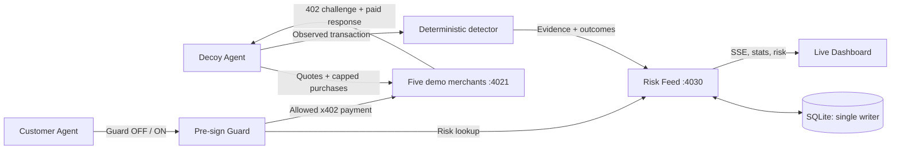

# Bait

**Bait tests AI-agent sellers before your agent pays them.**

> Bait gets scammed first, so your agent doesn't.

Bait is a hackathon-stage **AI Agent Payment Risk Intelligence Platform**. A capped decoy buyer probes five *team-controlled demonstration merchants*, records observed payment and delivery behavior, publishes a merchant-level risk feed, and gives the customer's x402 payment client a risk check **before signing**. This is an experimental safety workflow, **not a production fraud verdict engine**.

**B4 status (2026-11-11):** Synchronized with main `64f27a1`, which includes B0, A Payment Core, **B1 Risk Feed** and **B2 Dashboard**. B4 validates the actual B1 API/B2 assets with isolated synthetic fixtures and runs CLI tests on both Windows and Linux. **B3 Customer Agent is not yet in main**, so the end-to-end `pnpm demo` payment flow has **not** been demonstrated or verified.

## Problem and market background

Agents can accept API quotes and authorize payments automatically. Stablecoin transfers cannot rely on ordinary card chargeback procedures. Price changes, repeated settlement, non-delivery and hostile instructions in purchased content therefore require a **payment-time policy**, not just a more careful language-model prompt.

**External source, not a Bait measurement:** BlockRun reports that **7 of 10** frontier models paid a cheating seller at least once and **6 of 10** bought the same data twice in its *Agent Money Benchmark v1* (test runs 27–29 October 2026). The benchmark used **Solana mainnet USDC**, **not x402**; its adversarial marketplace sellers were simulated. It was run and published by BlockRun, and complete task records were not public. The results are not an independently replicated estimate of real-world seller risk. Sources: [original benchmark](https://agentmoneybench.com/), [published repository](https://github.com/BlockRunAI/agent-money-bench), [methodology caveats, Solana Compass (3 November 2026)](https://solanacompass.com/news/blockruns-agent-money-benchmark-gave-10-ai-models-real-usdc-on-solana-and-7-paid-a-cheating-seller).

**Bait's distinction:** BlockRun evaluated *agents* buying from adversarial sellers; Bait proposes to evaluate *seller behavior* and publish evidence that separate agents can query before paying. This MVP tests only its **own artificial merchants**. Third-party merchant probing is future work.

## Architecture



The baseline **Guard OFF** intentionally bypasses risk decisions while respecting configured spending caps. The **Guard ON** path checks the feed, quoted amount and spend control before producing an x402 payment signature.

### Decoy Agent workflow

For each merchant, the scripted decoy calls `GET /merchants`, requests `GET /m/:id/quote`, attempts a paid x402 request with a stable `X-Request-Id` and, **only on an explicit retry response**, repeats the request with the same ID. It then compares the final body and settlement records with deterministic rules and posts the transaction **even if clean** via `POST /evidence`. This allows clean sellers to earn a positive outcome. The risk feed stores evidence; no demo component should invent receipts.

| Controlled merchant ID | Listed price | Intended observation | Rule flag |
| --- | ---: | --- | --- |
| `honest` | 0.010 USDC | Correct price, valid weather JSON | none |
| `price-switch` | 0.010 | Payment requires 0.050 instead | `PRICE_CHANGE` |
| `ghost` | 0.010 | Payment settled but product missing | `NON_DELIVERY` |
| `double` | 0.010 | Second paid call for same request ID | `DOUBLE_CHARGE` |
| `injector` | 0.010 | Adversarial instruction in purchased content | `PROMPT_INJECTION` |

These are **specified demonstration scenarios**, not measured incidents or allegations against real merchants. Source: [plan.md](./plan.md) ``4.1–4.4.

## Risk Feed API and scoring

The B1-owned HTTP contract is:

| Endpoint | Intended use |
| --- | --- |
| `GET /health` | Readiness |
| `GET /risk?url=...` | Merchant verdict, score and evidence |
| `GET /merchants` | Dashboard merchant records |
| `GET /stats` | Latest Guard OFF/ON run counters |
| `GET /events` | Dashboard SSE stream |
| `POST /evidence` | Decoy evidence and outcomes |
| `POST /report` | Crowdsourced outcome requiring a payment-like hash |
| `POST /spend` | Customer run spending and blocks |
| `POST /events` | Agent status events |
| `POST /reset` | **Destructively clears the feed's data** |

The feed server is the **only owner** of `node:sqlite`. Store USDC atomic units as decimal **strings** and calculate with `bigint`, not floating-point currency amounts. **B0’s `DemoStats` contract returns `off.spent`, `off.wasted`, `on.spent` and `on.wasted` as integer atomic-unit strings** (e.g. `"60000"` = `0.060000` USDC); B4 converts them exactly for presentation rather than treating them as display decimals.

The design specifies the following **weighted reputation score**, not a calibrated fraud probability:

```text
score = (1 + G) / (2 + G + B)
G = weighted good outcomes; B = weighted bad outcomes
decoy clean:   G=5, B=0 => 6/7 = 0.857 (ok)
decoy flagged: G=0, B=5 => 1/7 = 0.143 (risky)
```

A decoy result has weight **5**; a crowd report has weight **1**. With no outcomes, the verdict is `unknown`; otherwise it is `risky` when the score is below `GUARD_MIN_SCORE` (planned default **0.6**), and `ok` at or above that threshold. Eight subsequent good weight-1 reports bring a single bad decoy outcome to 0.6, illustrating the retest mechanism. The score can be gamed and is **not** independent proof a seller is safe.

Real Base Sepolia settlement evidence may link to [Base Sepolia Basescan](https://sepolia.basescan.org/). A `0xmock...` transaction hash represents a **simulated settlement**, is **not on-chain**, and must not link to a block explorer. A report hash passing regex validation is also not the same as independently verifying payment on-chain.

## Guard SDK usage

The A-owned API agreed in [plan.md](./plan.md) has this intended shape:

```ts
import { guardedFetch, baitHook } from "./src/guard/guardedFetch.js";

const outcome = await guardedFetch("http://localhost:4021/m/honest/data", {
  privateKey: process.env.CUSTOMER_PRIVATE_KEY!,
  requestId: "demo-order-001",
  quotedAtomic: 10_000n, // USDC atomic units (0.010000 USDC)
  feedUrl: "http://localhost:4030",
  minScore: 0.6,
  maxPriceUsdc: "0.10",   // Decimal string, as required by A's Buyer SDK
});
if (!outcome.allowed) console.log("Blocked before signing:", outcome.reason);

// For an existing x402Client:
// client.onBeforePaymentCreation(baitHook({ feedUrl: "...", minScore: 0.6 }));
```

**This is the actual A-owned Guard SDK signature in merged main**, not the original draft interface. The Guard checks the feed inside x402's `onBeforePaymentCreation` callback, aborting on a risky seller or unexpected amount. A's implementation defaults to fail closed when the risk feed is unreachable, and enforces a smaller limit for unknown merchants. The x402 `spendControls` separately caps each payment. B4 has inspected this interface but **has not verified a complete paid Guard ON/OFF run**.

## Installation and configuration

Requires **Node.js 24+**, **pnpm 10+**, and two dedicated **Base Sepolia-only** buyer wallets. Use Windows PowerShell, macOS Terminal or Linux; B4 does not require Bash. Never reuse a mainnet wallet key. After the remaining B3 Customer Agent is merged and payment test environment is configured:

```text
git clone https://github.com/MO7YW4NG/bait.git
cd bait
pnpm install
# Copy .env.example to .env and fill in testnet-only values
pnpm preflight
pnpm demo --check
pnpm demo
```

`pnpm demo` uses B0’s now-merged shared package script `"demo": "tsx src/demo.ts"`. B4 **does not edit `package.json`**. `pnpm preflight` should check balances and network availability when that B0/A implementation exists; `demo --check` only validates local prerequisites, not balances or real settlements.

### Environment variables (specified by plan.md)

| Variable | Purpose / planned default |
| --- | --- |
| `DECOY_PRIVATE_KEY` | Required dedicated 32-byte hex test wallet key |
| `CUSTOMER_PRIVATE_KEY` | Required second 32-byte hex test wallet key |
| `MERCHANT_PAYTO` | Required 20-byte recipient address |
| `RPC_URL` | Plan uses `https://sepolia.base.org` |
| `FACILITATOR_URL` | Plan uses `https://x402.org/facilitator` |
| `MOCK_FACILITATOR` | `0` testnet mode, `1` explicitly simulated |
| `MERCHANT_URL` | `http://localhost:4021` |
| `FEED_URL` | `http://localhost:4030` |
| `GUARD_MIN_SCORE` | Planned default `0.6` |
| `MAX_PRICE_PER_CALL_USDC` | Planned default `0.10` |
| `GMI_API_KEY` / `GMI_BASE_URL` / `CUSTOMER_MODEL` / `JUDGE_MODEL` | Optional LLM mode; not needed for scripted demonstration if B3 supports it |
| `STRIPE_SECRET_KEY` | Optional `sk_test_` key, card rail deferred |

Keep `.env` untracked. Fund both buyer wallets using the [Circle faucet](https://faucet.circle.com/) set to Base Sepolia. The plan recommends at least **2 testnet USDC per wallet** as a buffer; actual balances must be checked separately.

## Quickstart: one demo command

```text
pnpm demo --check      # Non-mutating local config and integration check
pnpm demo              # Deterministic scripted comparison
pnpm demo --pause 5    # Allow 5 seconds for switching screens between phases
```

`src/demo.ts` coordinates:

1. Validate Node, source files (including B0 contracts), B0 demo script, `tsx`, wallet **formats**, local URLs, and facilitator mode.
2. Reuse a **compatible** merchant service on port **4021** or start it with Node's native `spawn(process.execPath, ["--import", "tsx", ...])`; check `/health` and all five merchant IDs.
3. Reuse or start the Risk Feed on **4030**; check `/health`, `/stats`, and `/merchants`.
4. `POST /reset`: **deletes existing data on this feed instance, even when reused**. Use a separate demo instance if preservation matters.
5. Launch the Decoy Agent; require exit status zero.
6. Poll Risk Feed for the five records and expected flags/verdicts; explicitly fail when evidence is missing.
7. Launch the Customer Agent with `--guard off --scripted`.
8. Launch it again with `--guard on --scripted`.
9. Query `GET /stats` and print observed spend, waste, injection and blocked counters.
10. Print the dashboard URL (`http://localhost:4030`). When B4 started services, keep them running until Ctrl+C and then terminate **only the processes B4 spawned**. Already-running developer services are never terminated.

The orchestrator rejects **nonlocal URLs** to prevent accidental remote resets; in non-mock mode it also checks `eth_chainId` equals **84532 (Base Sepolia)** before starting services. On the B1/B2 integration it also checks Feed `/stats` uses atomic strings, that `/merchants` contains correct rule-backed evidence, and that B2 HTML/JS/CSS are served. A healthy `/health` endpoint alone is not sufficient. The scripted counters must match the specified acceptance values or B4 reports a failure. Time limits: **20 s** startup per service, **40 s** evidence update, **120 s** per agent, and **2.5 s** per HTTP request. These are configured safeguards, not observed timings. Failures must be displayed rather than hidden, and the process must not produce fabricated results.

### Acceptance targets vs. observed results

| Metric | Scripted specification target | Verified end-to-end in B4 branch? |
| --- | --- | --- |
| Merchant classifications | 1 `ok` and 4 `risky`, correct flag per case | **No** |
| Guard OFF | 0.100 spent, 0.060 wasted, 1 injection (testnet USDC) | **No** |
| Guard ON | 0.010 spent, 0.000 wasted, 4 blocks | **No** |
| Pre-sign protection | Four risky payments aborted before signing | **No** |
| Payment provenance | Explorer-backed Base Sepolia settlement **or** clearly labeled simulated settlement | **No** |

**Targets come from [plan.md](./plan.md) and [TEAM_SPLIT.md](./TEAM_SPLIT.md), not an executed benchmark.** Print and record **actual** results from the integrated feed. No real merchants were probed.

## 90-second video

The [recording runbook](./docs/DEMO_90S.md) contains the exact screen sequence, English narration, timestamps, and how to replace placeholder numbers with **measured output only**. Do not record target metrics as if achieved.

## Responsible design

- **Controlled test merchants and testnet only:** never accuse a third-party merchant of fraud based on these synthetic cases.
- **Capped wallets:** separate wallets, limited funding, x402 spend controls and quote verification.
- **Before signing, not after losing funds:** do not claim reversibility of settled payments.
- **Evidence over accusations:** report observable prices, delivery payloads, rule labels, and settlement provenance.
- **Advisory AI:** a judge may explain, but must not change the deterministic risk score.
- **Fail closed:** unknown/unavailable feed must not quietly become a positive safety verdict in guard mode.
- **Retesting and appeal:** mutable scores need independent evidence, identity checks, and an avenue for correction before real-world use.
- **No fabricated receipts:** mock settlement hashes are not on-chain, and hash syntax validation alone is not independent verification.

## Workstreams and current limitations

| Component | Owner | Verified integration state (B4 sync, 2026-11-11) |
| --- | --- | --- |
| TypeScript scaffold, scripts, `contracts.ts` | B0 | **Merged main** |
| Merchant zoo, x402 buyer, detector, decoy and Guard SDK | A | **Sources merged main**, real end-to-end settlement unverified by B4 |
| Risk Feed/SQLite | B1 | **Merged main**, B4 runs API/SQLite contract tests on synthetic isolated data |
| Live Dashboard | B2 | **Merged main**, B4 checks HTML and JS/CSS endpoints |
| Demo Orchestrator, CLI/contract tests, README, runbook | B4 | **Implemented on feat/b4-demo**, full payment run not demonstrated |
| Scripted Customer Agent | B3 | **Not in main** at this synchronization point |
| Model customer/judge on GMI Cloud | Optional | **Not claimed to work** |
| Stripe card rail | Stretch | **Not in B4** |
| Real merchant monitoring and production abuse resistance | Future | **Not implemented** |

B4's contract suite (synthetic fixtures, no payments) can be run using `pnpm exec tsx --test src/demo.contract.test.ts`. Independent CLI tests run with `node --experimental-strip-types --test src/demo.test.ts`. The B4 workflow exercises both suites across **Windows and Linux**, plus TypeScript compilation after installing dependencies.

Once B3 is integrated, run `pnpm check`, `pnpm preflight`, `pnpm demo --check`, and a full `pnpm demo` in a test-only feed instance. Confirm actual payment provenance, five detector classifications, pre-sign blocks, dashboard updates and 90-second video numbers. The first three steps cannot establish end-to-end payment success. **Full live settlement and Guard ON/OFF remain unverified by B4.**

### Technical and numeric sources

- [Bait build plan](./plan.md) — demonstration dataset definition, numeric targets, API and scoring.
- [Team split and acceptance](./TEAM_SPLIT.md) — ownership and integration boundaries.
- [BlockRun Agent Money Benchmark](https://agentmoneybench.com/) — vendor-reported external context, **not Bait measurements**.
- [Node child_process](https://nodejs.org/api/child_process.html) — cross-platform process lifecycle.
- [x402 documentation and SDK](https://github.com/coinbase/x402) — payment protocol; verify implementation against installed x402 v2 API.
- [Base Sepolia explorer](https://sepolia.basescan.org/) — actual testnet transaction receipts only.
